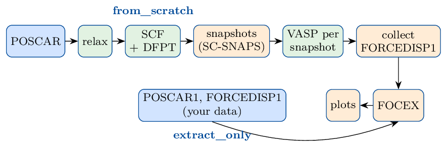

.. _focex-agent:

FOCEX agent: from a crystal structure to phonons
================================================

Version 1.2 (2026-10-27, with FOCEX 9.0). The same manual as a PDF: ``FOCEX/AGENT/focexagent_manual.pdf`` in the repository; the agent, its
instruction file and ``diagnose.py`` are in ``FOCEX/AGENT``.

What the FOCEX agent does
-------------------------

FOCEX obtains the force constants of a crystal (harmonic, cubic, quartic, ...) by fitting them to
the forces that density-functional theory (DFT) gives on the atoms of a supercell in which every
atom has been displaced a little at random (a *snapshot*). From the force constants it computes the
phonon dispersion, density of states, group velocities, Grüneisen parameters, elastic constants,
sound speeds and the thermal expansion; THERMACOND then computes the lattice thermal conductivity
from the same files.

Making those forces takes many steps: relax the crystal, orient the cell the way FOCEX expects,
compute the Born charges of an insulator, choose a supercell, generate the snapshots, run one DFT
calculation per snapshot, collect the forces, write the five input files of FOCEX and run it. Each
step has its own input files and its own ways to fail. The FOCEX agent, ``focex-agent.py``, does
them all from one short *instruction file*, checks the result of every step, writes what it did to
``report.log``, and can be restarted at any time: finished steps are not repeated. When a run
stops, ``diagnose.py`` finds out where and why, and writes a script that repairs it
(:ref:`agent-diagnose`).

It works in one of two modes:

.. list-table::
   :header-rows: 1
   :widths: 16 40 44

   * - Mode
     - You give
     - The agent does
   * - **from_scratch**
     - a crystal structure (``POSCAR``) and the instruction file
     - VASP relaxation, SCF and Born charges; SC-SNAPS snapshots; one VASP run per snapshot;
       FOCEX; plots (:ref:`agent-scratch`)
   * - **extract_only**
     - existing supercells and their forces (``POSCAR1``, ``FORCEDISP1``, ...) and the
       instruction file
     - rotates the data into the FOCEX frame; FOCEX; plots (:ref:`agent-extract`)

   Green: VASP; orange: SC-SNAPS, FOCEX and their tools; blue: your input.

What you need, and how to install it
------------------------------------

You do not need to have used VASP-Flow before: the agent uses it as a library, to write the VASP
input files and the batch scripts. This section has everything you need to set up.

The programs
~~~~~~~~~~~~

.. list-table::
   :header-rows: 1
   :widths: 22 45 33

   * - What
     - Needed for
     - How to get it
   * - VASP 5.4 or newer
     - every DFT step (from_scratch only)
     - your licence; on a cluster usually a module
   * - POTCAR library
     - VASP: the PAW potentials, one folder per element
     - comes with VASP
   * - MPI
     - running VASP in parallel (``mpirun`` or ``srun``)
     - system or cluster module
   * - Python ≥ 3.8 with numpy, spglib, pymatgen
     - the agent and ``diagnose.py``
     - a virtual environment, below
   * - VASP-Flow
     - writes the VASP inputs and batch scripts
     - ``git clone``, below
   * - FOCEX, ``read_outcar.x``
     - the fit; reading the forces from the OUTCARs
     - this repository, ``make focex``
   * - SC-SNAPS (``sc_snaps.x``)
     - the snapshots (from_scratch only)
     - this repository, ``make sc_snaps``
   * - gnuplot
     - the plots (PDF)
     - ``brew install gnuplot``, ``apt install gnuplot``, or a module
   * - a Fortran compiler
     - building FOCEX and SC-SNAPS
     - ``gfortran`` (GCC)

Install, once
~~~~~~~~~~~~~

The same commands on a workstation and on the login node of a cluster (there, load Python 3.8+
and GCC first, e.g. ``module load gcc python``).

.. code-block:: bash

   cd ~
   # 1. this repository: FOCEX, its utilities, SC-SNAPS, the agent
   git clone https://github.com/KeivanS/Anharmonic-lattice-dynamics.git
   cd Anharmonic-lattice-dynamics
   make focex sc_snaps     # FOCEX, read_outcar.x, ..., sc_snaps.x -> ~/ALADYN/bin (3 min)
                           # plain "make" also builds THERMACOND (needs MPI) and ANFOMOD
   cd ~

   # 2. VASP-Flow; the agent imports it from ~/VASP-Flow
   #    (another place: export VASP_FLOW_DIR=/that/place)
   git clone https://github.com/KeivanS/VASP-Flow.git

   # 3. one Python environment for VASP-Flow and the FOCEX agent
   python3 -m venv ~/dftphonon-env
   source ~/dftphonon-env/bin/activate
   pip install numpy spglib pymatgen matplotlib

   # 4. optional: the commands focex-agent and focex-diagnose (symlinks in ~/ALADYN/bin)
   (cd Anharmonic-lattice-dynamics && make python-tools)
   export PATH=~/ALADYN/bin:$PATH     # put this line in ~/.bashrc

The agent finds the programs at these places; a program installed elsewhere is named in the
instruction file (``FOCEX_X``, ``SC_SNAPS_X``, ``READ_OUTCAR_X``, :ref:`agent-keywords`). With step 4 and the environment active, ``focex-agent`` and ``focex-diagnose`` are
short for ``python .../FOCEX/AGENT/focex-agent.py`` and ``python .../FOCEX/AGENT/diagnose.py``.

Tell VASP-Flow where VASP, MPI and the POTCARs are
~~~~~~~~~~~~~~~~~~~~~~~~~~~~~~~~~~~~~~~~~~~~~~~~~~

**The POTCAR library** is always given by an environment variable. Put it in your ``~/.bashrc``
(or ``~/.zshrc``) so that every job sees it:

.. code-block:: bash

   export VASP_POTCAR_DIR=/path/to/potpaw_PBE.54     # holds Zn/, O/, Ga/, ...

**VASP and MPI** come from a *profile*, a small JSON file in ``~/VASP-Flow/profiles/``, chosen with
``--profile`` (or ``PROFILE:`` in the instruction file):

.. list-table::
   :header-rows: 1
   :widths: 16 84

   * - profile
     - use it for
   * - (none)
     - a workstation. VASP from the variables ``VASP_STD`` (default ``~/BIN/vasp_std``) and
       ``MPI_LAUNCH`` (default ``mpirun -np``), set in ``~/.bashrc``; the number of ranks is
       ``MPI:`` in the instruction file; ``run_workflow.sh`` is started with ``bash``
   * - ``workstation``
     - the same, with the paths written in ``profiles/workstation.json`` instead
   * - ``slurm``
     - a template for a SLURM cluster: edit ``profiles/slurm.json`` (VASP command, ``modules`` to
       load, partition, nodes, tasks per node, time, account)
   * - *your own* (``mycluster`` below)
     - your cluster: copy ``slurm.json`` to ``mycluster.json``, edit it, and use
       ``--profile mycluster``

With a SLURM profile, ``run_workflow.sh`` begins with the ``#SBATCH`` lines and the
``module load`` lines of the profile and is submitted with ``sbatch``.

Check the set-up
~~~~~~~~~~~~~~~~

.. code-block:: bash

   source ~/dftphonon-env/bin/activate
   python ~/VASP-Flow/check_setup.py local     # a workstation;  "slurm" on a cluster

It checks Python and its packages, the POTCAR library, VASP and MPI (and on a cluster the
profile), and prints for every problem the command that fixes it. **Ready.** at the end means you
can start.

When is the Python environment needed?
~~~~~~~~~~~~~~~~~~~~~~~~~~~~~~~~~~~~~~

It is the same environment as in VASP-Flow's manual: one, ``~/dftphonon-env``, serves both (DFT with
VASP-Flow, phonons with the FOCEX agent). It is needed whenever *you* start ``focex-agent.py`` or
``diagnose.py``: they import numpy, spglib, pymatgen and
VASP-Flow. Either activate it first (``source ~/dftphonon-env/bin/activate``, then ``python ...``) or
call its interpreter directly (``~/dftphonon-env/bin/python ...``). The scripts the agent writes
(``run_workflow.sh``, ``resubmit_failed.sh``, ``diagnosis/fix_it.sh``) contain the full path of the
interpreter you used, so the batch jobs need no activation. The plots need only gnuplot; without it
the agent writes the plot scripts and you run ``makeplots.sh`` later, where gnuplot is.

Quick start
-----------

The steps of a from_scratch calculation (:ref:`agent-extract` has those of extract_only):

#. **Make a folder** for the material with its crystal structure, in VASP's POSCAR format, named
   ``POSCAR``. Any cell of the crystal will do -- primitive or not, any orientation: the agent
   reduces and orients it.
#. **Copy the instruction file** ``FOCEX/AGENT/focex-agent-instructions.txt`` into that folder and
   edit it. Only two lines are required: ``Project:`` (a name) and ``RANKS:`` (which force
   constants to fit, e.g. ``1 1 1 0 0 0 0 0`` for harmonic and cubic). Set also ``FUNCTIONAL:``
   and ``MPI:`` (the number of MPI ranks for VASP); every other line is optional and shows its
   default.

   **Where the calculations go** is also set in this file, by ``PROJECT_DIR:``: a path relative to
   the folder of the instruction file (``PROJECT_DIR: runs/ZnO_PBEsol``) or absolute
   (``PROJECT_DIR: /scratch/me/ZnO``, ``~`` allowed). Without it the project folder is a folder
   named after ``Project:`` next to the instruction file. The agent creates it, with any missing
   parent folders; if it holds a project already, the agent stops unless ``--force`` is given.
#. **Set up the project**: the agent creates the project folder with the relaxation inputs and
   ``run_workflow.sh``, and prints the command to start it. This takes seconds and runs no VASP.
#. **Start the workflow** from the project folder, and follow ``report.log``.
#. **If it stops**, run ``diagnose.py`` (:ref:`agent-diagnose`).

.. code-block:: bash

   cd ~/work/ZnO                      # holds POSCAR
   A=~/Anharmonic-lattice-dynamics/FOCEX/AGENT
   cp $A/focex-agent-instructions.txt .
   nano focex-agent-instructions.txt  # Project, RANKS, FUNCTIONAL, MPI

   source ~/dftphonon-env/bin/activate
   python $A/focex-agent.py --profile mycluster   # your profile (above)
   cd ZnO
   sbatch run_workflow.sh             # without a profile: nohup bash run_workflow.sh &
   tail -f report.log

The options of ``focex-agent.py`` are all optional:

.. list-table::
   :header-rows: 1
   :widths: 22 78

   * - option
     - meaning
   * - ``--instr FILE``
     - the instruction file, if it is not called ``focex-agent-instructions.txt``
   * - ``--coord FILE``
     - the crystal structure, if it is not called ``POSCAR`` (from_scratch)
   * - ``--profile NAME``
     - the VASP-Flow profile (previous section); default: ``PROFILE:`` of the instruction file,
       else none
   * - ``--force``
     - set up again a project folder that exists already. Its record of finished tasks is reset,
       so use it only to start over, after removing the old run folders

.. note::

   **Threads.** You do not have to do anything about OpenMP threads: the agent runs VASP with one
   thread per MPI rank (``OMP_NUM_THREADS=1``). Without that, a BLAS library built with OpenMP
   starts one thread per core in every MPI rank and the cores are oversubscribed many times (a
   96-atom ZnO supercell made no SCF step in 30 minutes on 8 ranks). Only if your VASP is built
   for hybrid MPI + OpenMP runs and you want them, set ``VASP_OMP_NUM_THREADS`` to the number of
   threads per rank before you start the workflow.

.. _agent-scratch:

Mode from_scratch: from a POSCAR to phonons
-------------------------------------------

``run_workflow.sh`` runs ``focex-agent.py run <PROJECT_DIR>``, which does the eleven tasks below in
order. Each finished task is recorded in ``state.json`` and in ``report.log``, with what was
checked; a task that fails stops the workflow, and starting ``run_workflow.sh`` again continues
from that task. A job that hits its time limit is simply submitted again.

The supercell tasks are checked again before they are skipped:

- **A removed or incomplete ``04_supercells/snap_NNN`` folder** is written again, and the
  ``supercells`` task and every task after it are redone. Only the folders without a converged
  OUTCAR run VASP.
- **To leave snapshots out on purpose**, move their folders to ``04_supercells/unused/``. They
  are then not recreated, and ``FORCEDISP1`` is collected again from the others.
- **A ``snap_NNN`` folder with no ``03_snaps/poscar_NNN``** stops the workflow.
- **To add snapshots**, raise ``SNAPSHOTS`` in the project's ``focex-agent-instructions.txt`` and
  start ``run_workflow.sh`` again. The extra snapshots are made at the same temperature and numbered
  after the existing ones, which are kept; only the new ones run VASP, then FOCEX is run again on
  all of them. A lower ``SNAPSHOTS`` removes nothing.

``relax``
   The structure you gave is reduced to its primitive cell (Niggli reduction) and rotated into
   the orientation FOCEX and SC-SNAPS use (:ref:`agent-frame`); the result is ``POSCAR.init``.
   VASP relaxes the atoms and the cell shape and volume in ``01_relax``. If the forces are not yet
   below EDIFFG after NSW ionic steps, the relaxation continues from its last structure (CONTCAR),
   up to three times.
``poscar0``
   The relaxed cell is reduced and oriented again and written as ``POSCAR0``: every later step
   uses this cell and this Cartesian frame. The report gives its space group and lattice
   parameters.
``scf``
   A self-consistent calculation on POSCAR0 in ``02_scf`` (same INCAR, no ionic steps, same
   k-mesh), which also gives the band gap. If the cell did not change in the previous task, it
   starts from the charge density and wave functions of the relaxation.
``dfpt``
   For an insulator (band gap above 0.05 eV, ``DFPT: auto``): density-functional perturbation
   theory in ``02_scf/dfpt`` gives the high-frequency dielectric constant and the Born effective
   charges of every atom (:ref:`agent-born`). ``DFPT: on`` forces it, ``off`` skips it.
``snaps``
   The supercell is chosen (:ref:`agent-supercell`). SC-SNAPS (``03_snaps``)
   then writes the undistorted supercell ``poscar_000`` and 50 snapshots, each atom displaced as in
   a thermal ensemble of harmonic oscillators of frequency ``AVG_FREQ`` at temperature
   ``TEMPERATURE``. **A temperature you give is used as it is**, e.g. to sample the
   displacements of that temperature for effective phonons; the report gives the resulting rms
   displacement. Only when ``TEMPERATURE`` is not given, the default 30 K is adjusted (SC-SNAPS
   rerun at most twice) until the rms displacement is within 15 % of ``DISP_TARGET`` (0.02 Å):
   large enough for clean forces, small enough for the Taylor expansion of the energy. The
   undistorted supercell is checked to be an
   exact multiple of POSCAR0 before any VASP job is run.
``supercells``
   One folder per snapshot, ``04_supercells/snap_NNN``, with its POSCAR, the SCF INCAR without
   symmetry (``ISYM = 0``) and a k-mesh equivalent to the SCF one (:ref:`agent-kmesh`); magnetic
   moments given per atom are carried over to the supercell.
``vasp_snaps``
   The VASP runs of the snapshots, one after the other. A run that fails does not stop the others;
   the failed ones are listed in ``report.log``, and ``resubmit_failed.sh`` reruns only those. An
   existing OUTCAR is never overwritten (it is kept as ``OUTCAR.1``, ...).
``collect``
   ``read_outcar.x`` reads the positions and forces of every run into
   ``04_supercells/FORCEDISP1``; ``POSCAR1`` is the undistorted supercell. The report gives the
   largest net force on a supercell (should be ≈ 0) and the largest difference between the
   positions in OUTCAR and in POSCAR. The undistorted supercell (``snap_000``, run with
   ``ISIF = 2``; the other snapshots use ``ISIF = 1``, which gives only the trace) also gives the
   stress of the reference structure: ``stress.params`` (GPa, tensile positive, i.e. minus the
   ``in kB`` line of OUTCAR divided by 10) is written and copied to the FOCEX folders, where it
   enters the Huang rows and the elastic constants (:ref:`focex-stress-params`).
``focex``
   The five input files of FOCEX are written in ``05_focex`` (``structure.params``,
   ``latdyn.params``, ``kpbs.params``, ``dielectric.params``, ``default.params``) and FOCEX is run.
   With Born charges a second run without them is made in ``05_focex/NOBORN``, for comparison; with
   fewer than ``LASSO_RATIO`` (2) equations per unknown, a third run with LASSO, which keeps only
   the force constants the data need, is made in ``05_focex/LASSO``. The report gives the fit
   error, the numbers of equations and unknowns, the lowest ω² (a warning below −25 cm⁻²:
   imaginary modes) and the highest frequency. If the DOS range of ``latdyn.params`` does not fit
   the frequencies, FOCEX is run again with one that does.
``plots``
   The gnuplot scripts ``bvel.plt``, ``all.plt``, ``qha.plt`` are filled in and run in every FOCEX
   folder (:ref:`agent-results`); ``makeplots.sh`` remakes them.
``thermacond``
   THERMACOND in ``06_thermacond``: linewidths or the thermal conductivity, when ``THERMACOND_JOB``
   is 1, 2 or 3; skipped for 0, the default (:ref:`agent-thermacond`).

Defaults
~~~~~~~~

- ``ACCURACY: Accurate``: ENCUT 600 eV, EDIFF 10⁻⁷ eV, EDIFFG −0.001 eV/Å, PREC Accurate in every
  VASP step. ``Normal``: 450 eV, 10⁻⁶, −0.003, PREC Normal -- cheaper, but the residual forces of
  the relaxed structure are larger (0.01 eV/Å in a ZnO test), which adds noise to the force
  constants. DFPT uses EDIFF 10⁻⁸.
- Relaxation and SCF k-mesh: VASP-Flow's ``coarse`` density (1000 k-points per reciprocal atom),
  ``fine`` (6000) if every element is a metal. Each subdivision is rounded to the nearest integer;
  VASP-Flow itself rounds to even numbers (multiples of 6 in plane for hexagonal cells), the agent
  does not. The FOCEX mesh (``FOCEX_MESH``) is made the same way.
- 50 snapshots. Each gives three equations per atom of the supercell: 20 snapshots of a 96-atom
  supercell give 5760 equations for the 264 unknowns of ZnO with ranks 1--3, so fewer snapshots are
  often enough (``SNAPSHOTS``).
- ``RANGE: 6 2 1 0 0 0 0``: neighbour shells kept for ranks 2, 3, 4, ...; ``FC2RANGE: 0``: the
  harmonic force constants are kept over the whole supercell.
- FOCEX k-mesh ``fine``; the band-structure path is found automatically.

.. _agent-supercell:

The supercell
~~~~~~~~~~~~~

``SUPERCELL:`` takes one of three forms:

- ``SMALL`` (the default): the multiple m1×m2×m3 of the conventional cell with the fewest atoms
  whose faces are at least 10 Å apart, at most 100 atoms;
- ``LARGE``: the same with 14 Å and at most 300 atoms. In both, if no such multiple is small
  enough, the one with the largest face distance; it keeps the symmetry of the lattice;
- **the supercell matrix itself**: nine integers, the three rows of the matrix that the agent
  writes to SC-SNAPS's ``supercell.inp``. The first three integers n11 n12 n13 give the first
  supercell vector as a combination of the primitive vectors of POSCAR0,
  R\ :sub:`S1` = n11 R\ :sub:`01` + n12 R\ :sub:`02` + n13 R\ :sub:`03`; the next three give
  R\ :sub:`S2` and the last three R\ :sub:`S3` in the same way (the agent's ``cell.inp`` has
  ``convcoord = 1``, primitive units). For example
  ``SUPERCELL: 2 0 0  0 2 0  0 0 2`` is 2×2×2 primitive cells, and for an fcc crystal
  ``SUPERCELL: -1 1 1  1 -1 1  1 1 -1`` is its conventional cube (4 primitive cells). The
  determinant must be positive.

The report gives the matrix and the number of atoms (for SMALL and LARGE also the face distance). Prefer supercells that keep the symmetry of the lattice: with a supercell that does not (for
example 4×3×2 of a hexagonal cell), FOCEX can stop with ``R+tp-t not inside!``
(:ref:`agent-diagnose`).

.. _agent-frame:

The FOCEX frame
~~~~~~~~~~~~~~~

FOCEX and SC-SNAPS build the conventional cell from a, b, c, α, β, γ with a along x and b in the
xy plane, and the supercells, forces and Born charges must be in that same Cartesian frame. The
agent rotates the cell into it at the start, so everything VASP computes is already in the right
frame. ``structure.params`` lists the conventional cell (line 1), the primitive vectors in its
units (line 2) and the atoms in conventional coordinates.

.. _agent-kmesh:

The k-mesh of the supercells
~~~~~~~~~~~~~~~~~~~~~~~~~~~~

If the supercell is a diagonal multiple of the primitive cell, its mesh is the SCF mesh divided by
the multiples, rounded up (6 6 4 with a 3×3×2 supercell gives 2 2 2). Otherwise (every multiple of
a centred conventional cell) it keeps the k-point spacing of the SCF mesh. ``KPOINTS_snaps`` sets
it yourself (:ref:`agent-override`).

.. _agent-extract:

Mode extract_only: FOCEX on existing data
-----------------------------------------

Use it when the supercell forces exist already -- from an earlier calculation, another code, or a
colleague -- and you want FOCEX's force constants and phonons. No VASP and no SC-SNAPS are run.

**The data folder** (named in the instruction file with ``DATA:``) holds

- ``POSCAR1`` and ``FORCEDISP1``: a supercell and the positions and forces of its snapshots, in
  FOCEX's format (what ``read_outcar.x`` or ``read_qe.x`` write); more pairs
  ``POSCAR2``/``FORCEDISP2``, ... are all used. Any orientation.
- optionally ``POSCAR``: the primitive cell, in the same orientation as the data; without it,
  spglib finds the primitive cell of ``POSCAR1``.
- optionally ``dielectric.params``: the dielectric constant and the Born charges, in the frame of
  the data, one 3×3 block per atom of that primitive cell. With more than one atom of a species the
  primitive ``POSCAR`` is required, to fix the order of the atoms.

``SPECIES: Mg O`` names the elements when the POSCARs have no element line.

**What the agent does.** At set-up it symmetrizes the lattice of the primitive cell (DFT lattice
parameters given to 6--7 digits make FOCEX's symmetry analysis lose force constants), finds the
rotation into the FOCEX frame, and rotates the supercells, the positions and forces in
``FORCEDISPi``, the dielectric constant and the Born charges with it. The report gives the rotation
and the size of the symmetrization. The workflow then has only the tasks focex and plots.

.. code-block:: bash

   cat > focex-agent-instructions.txt <<'EOF'
   Project: MgO
   MODE: extract_only
   DATA: ~/data/MgO_forces          # POSCAR1, FORCEDISP1, dielectric.params
   SPECIES: Mg O
   RANKS: 1 1 1 0 0 0 0 0
   EOF
   python ~/Anharmonic-lattice-dynamics/FOCEX/AGENT/focex-agent.py
   cd MgO && bash run_workflow.sh          # FOCEX takes minutes: no batch job needed

Checked on MgO data given in a rhombohedral orientation: the fit error (7.197 %), the 35 unknowns,
the frequencies and the elastic moduli are those of a FOCEX run in the original frame.

.. _agent-keywords:

The instruction file: every keyword
-----------------------------------

One keyword per line, ``KEYWORD: value``; ``#`` starts a comment. The VASP keywords are those of
VASP-Flow (its manual lists all of them); the common ones are below.

.. list-table::
   :header-rows: 1
   :widths: 20 21 59

   * - keyword
     - default
     - meaning
   * - **project**
     -
     -
   * - ``Project``
     - (required)
     - a name, used in titles and as the default folder
   * - ``PROJECT_DIR``
     - the Project name
     - folder of the calculations, relative to the instruction file or absolute; created by the
       agent
   * - ``MODE``
     - from_scratch
     - or extract_only
   * - ``DATA``
     - --
     - extract_only: the data folder
   * - ``SPECIES``
     - --
     - extract_only: element names, if the POSCARs have none
   * - ``PROFILE``
     - none
     - the VASP-Flow profile, as ``--profile``
   * - **force constants**
     -
     -
   * - ``RANKS``
     - (required)
     - 8 flags for ranks 1--8: ``1 1 0 0 0 0 0 0`` harmonic, ``1 1 1 0 0 0 0 0`` + cubic,
       ``1 1 1 1 0 0 0 0`` + quartic
   * - ``RANGE``
     - 6 2 1 0 0 0 0
     - neighbour shells for ranks 2--8
   * - ``FC2RANGE``
     - 0
     - 0: harmonic range = the supercell
   * - ``LASSO_RATIO``
     - 2
     - below this many equations per unknown, an extra LASSO run
   * - **VASP (VASP-Flow keywords)**
     -
     -
   * - ``FUNCTIONAL``
     - R2SCAN
     - PBE, PBEsol, LDA, AM05, R2SCAN, HSE06, VV10
   * - ``MPI``
     - the profile's
     - MPI ranks for VASP
   * - ``ACCURACY``
     - Accurate
     - or Normal (:ref:`agent-scratch`)
   * - ``ENCUT``
     - by ACCURACY
     - plane-wave cutoff (eV)
   * - ``KMESH_DENSITY``
     - coarse or fine
     - k-mesh of the relaxation and SCF
   * - ``MAGMOM``
     - --
     - magnetic moments, e.g. ``MAGMOM: Cr=3.0``
   * - ``GGA_U``
     - auto
     - Hubbard U from VASP-Flow's table: ``auto`` applies it to d/f elements when the compound has
       O, S, Se, Te or a halogen; ``ON`` always; ``OFF`` never
   * - ``DFPT``
     - auto
     - Born charges: auto (if there is a gap), on, off
   * - ``BORN_TRANSPOSE``
     - yes
     - :ref:`agent-born`
   * - **snapshots**
     -
     -
   * - ``SUPERCELL``
     - SMALL
     - SMALL, LARGE, or the 9 integers of the supercell matrix, as in ``supercell.inp`` (rows,
       primitive units; :ref:`agent-supercell`)
   * - ``SNAPSHOTS``
     - 50
     - number of snapshots; can be raised later (:ref:`agent-scratch`)
   * - ``TEMPERATURE``
     - 30
     - K; given: used as is; not given: 30 K adjusted to DISP_TARGET
   * - ``AVG_FREQ``
     - 400
     - cm⁻¹, the frequency of the oscillators of SC-SNAPS
   * - ``DISP_TARGET``
     - 0.02
     - Å, the rms displacement wanted (only without TEMPERATURE)
   * - **FOCEX**
     -
     -
   * - ``FOCEX_MESH``
     - fine
     - k-mesh of latdyn.params: coarse, fine, a density, or 3 integers
   * - ``KPATH``
     - 0
     - 0: automatic band path; 1: give a ``kpbs_params`` block
   * - ``BS_NKPTS``
     - 40
     - points per segment of the band path
   * - **THERMACOND** (:ref:`agent-thermacond`)
     -
     -
   * - ``THERMACOND_JOB``
     - 0
     - 0 none; 1 linewidths; 2 kappa, direct; 3 kappa, iterative (latdyn line 8)
   * - ``THERMACOND_MESH``
     - the FOCEX mesh
     - n1 n2 n3 (line 1)
   * - ``THERMACOND_T``
     - 0 900 31
     - Tmin Tmax (K), number of temperatures (line 6)
   * - ``THERMACOND_SOLVER``
     - 0
     - job 2: 0 conjugate gradient, 1 SVD (line 9)
   * - **programs**
     -
     -
   * - ``FOCEX_X``
     - newest ``~/ALADYN/bin/focex-*.x``
     - the FOCEX binary
   * - ``SC_SNAPS_X``
     - ``~/ALADYN/bin/sc_snaps.x``
     - SC-SNAPS
   * - ``READ_OUTCAR_X``
     - ``~/ALADYN/bin/read_outcar.x``
     - reads OUTCARs
   * - ``THERMACOND_X``
     - newest ``~/ALADYN/bin/tcond-*.x``
     - THERMACOND (MPI build)

.. _agent-override:

Changing the files the agent writes
-----------------------------------

Every file the agent generates can be changed *from the instruction file*, with a block named after
the file: a line with its name, the contents, and a line with the name followed by ``_END``.

- **INCAR blocks are merged tag by tag**: the tags you give replace or add to those the agent
  writes; the others stay. ``INCAR`` applies to every VASP step; ``INCAR_relax``, ``INCAR_scf``,
  ``INCAR_dfpt``, ``INCAR_snaps`` to one.
- **Every other block replaces the whole file**, so it must be complete: ``KPOINTS`` (relaxation
  and SCF), ``KPOINTS_snaps``, ``cell_inp``, ``supercell_inp``, ``snaps_inp`` (SC-SNAPS),
  ``structure_params``, ``latdyn_params``, ``kpbs_params``, ``dielectric_params``,
  ``default_params`` (FOCEX).

Simple choices -- the supercell, the number of snapshots, the FOCEX k-mesh -- have their own
keyword; use a block only for what has none.

**Example.** Wurtzite ZnO without Hubbard U (VASP-Flow would otherwise put its tabulated U on Zn,
an oxide), ``LASPH`` in every VASP step, stricter electronic convergence only in the supercell
runs, a 3×3×2 supercell, 20 snapshots, a denser FOCEX mesh, and your own band path
Γ--M--K--Γ--A, which replaces ``kpbs.params``:

.. code-block:: text

   Project: ZnO
   RANKS: 1 1 1 0 0 0 0 0
   FUNCTIONAL: PBEsol
   GGA_U: OFF
   MPI: 40
   SUPERCELL: 3 0 0  0 3 0  0 0 2       # rows: supercell vectors in primitive units
   SNAPSHOTS: 20
   FOCEX_MESH: 12 12 8
   KPATH: 1                              # the band path is given below

   INCAR                                 # every VASP step (merged tag by tag)
     LASPH = .TRUE.
   INCAR_END
   INCAR_snaps                           # the supercell runs only
     NELM = 200
     ALGO = All
   INCAR_snaps_END
   kpbs_params                           # replaces kpbs.params (FOCEX's band path)
   1        # coordinates in units of the primitive reciprocal vectors
   60       # k-points per segment
   4        # number of segments
   G   0.000000 0.000000 0.000000
   M   0.500000 0.000000 0.000000
   K   0.333333 0.333333 0.000000
   G   0.000000 0.000000 0.000000
   A   0.000000 0.000000 0.500000
   kpbs_params_END

After the set-up you can read ``01_relax/INCAR`` before anything runs.

.. _agent-born:

Born charges and the dielectric constant
----------------------------------------

In an insulator, the long-range Coulomb interaction between the displaced ions splits the
longitudinal and transverse optical modes near Γ (LO--TO splitting). FOCEX includes it with the
Born effective charges Z* and the high-frequency dielectric constant ε∞; without them the optical
branches near Γ are wrong.

- from_scratch: the agent computes them (task dfpt) when the SCF shows a band gap, writes them to
  ``dielectric.params``, and makes for comparison a FOCEX run without them in
  ``05_focex/NOBORN``. ``DFPT: off`` skips them; ``on`` computes them for any material.
- extract_only: give them in ``dielectric.params`` in the data folder.
- your own values, in either mode: a ``dielectric_params`` block (it replaces the file).

.. note::

   VASP prints Z*\ :sub:`ij` with i the direction of the field and j that of the displacement;
   FOCEX expects the transpose, which the agent writes. ``BORN_TRANSPOSE: no`` writes them as VASP
   prints them; you should not need it.

.. _agent-results:

The project folder and the results
----------------------------------

.. list-table::
   :header-rows: 1
   :widths: 37 63

   * - file or folder
     - what it is
   * - ``focex-agent-instructions.txt``
     - the copy of your instruction file that the runs read
   * - ``report.log``
     - one entry per task: OK or FAILED, minutes, what was checked -- read this first
   * - ``state.json``
     - the finished tasks and the numbers passed between them
   * - ``run_workflow.sh``
     - the job; ``resubmit_failed.sh`` reruns the failed supercell runs
   * - ``POSCAR.input``, ``POSCAR.init``, ``POSCAR0``
     - your structure; reduced and oriented; relaxed
   * - ``01_relax``, ``02_scf``, ``02_scf/dfpt``
     - VASP: relaxation, SCF, Born charges
   * - ``03_snaps``
     - SC-SNAPS input and the snapshots ``poscar_NNN``
   * - ``04_supercells``
     - ``snap_NNN/`` (one VASP run each), ``POSCAR1``, ``FORCEDISP1``
   * - ``05_focex``
     - FOCEX: inputs, outputs, plots; ``NOBORN/`` and ``LASSO/`` when made
   * - ``06_thermacond``
     - THERMACOND (``THERMACOND_JOB`` 1-3): ``kappa_vs_T.dat``, ``kappa_wigner.dat``, ...
   * - ``diagnosis``
     - written by ``diagnose.py``: ``report.txt``, ``fix_it.sh``, backups

In ``05_focex``: the force constants ``fc2.dat``, ``fc3.dat``, ... with the cell in ``lat_fc.dat``;
the dispersion ``bs_freq.dat``; the elastic constants and moduli ``mech.dat``; thermodynamics and
thermal expansion ``thermo_QHA.dat``; and three PDFs: ``<Project>.pdf`` (the dispersion coloured by
group velocity, and the group velocities against frequency), ``all-<Project>.pdf`` (Grüneisen
parameters, density of states, dispersion) and ``qha.pdf`` (thermal expansion, Grüneisen
parameter, bulk modulus, thermodynamic functions, free energy against volume). :doc:`runfocex`
describes every output file. The large VASP files (WAVECAR, CHGCAR, CHG, ...) are deleted when no
longer needed; the OUTCARs never.

.. _agent-diagnose:

When a run stops: diagnose.py
-----------------------------

.. code-block:: bash

   A=~/Anharmonic-lattice-dynamics/FOCEX/AGENT
   python $A/diagnose.py ~/work/ZnO/ZnO     # one or more project folders
   less ~/work/ZnO/ZnO/diagnosis/report.txt
   bash ~/work/ZnO/ZnO/diagnosis/fix_it.sh

``diagnose.py`` itself changes nothing. It lists every task as done, FAILED, INTERRUPTED (the job
was killed inside it) or not reached, or reports that the project is still running or not yet
started. For a failed task it finds the cause from ``report.log``, the OUTCARs, ``vasp.out``,
``focex.out`` and the SLURM logs, and writes ``diagnosis/report.txt`` (what failed, where, the
evidence, what the fix will change) and ``diagnosis/fix_it.sh``. VASP failures are recognised with
the rules of VASP-Flow's diagnosis tool; FOCEX, SC-SNAPS and ``read_outcar.x`` stops by their
messages.

.. list-table::
   :header-rows: 1
   :widths: 20 40 40

   * - cause
     - meaning
     - what fix_it.sh does
   * - ``timeout``
     - the job hit its time limit
     - walltime × 2, resubmit
   * - ``scf_nelm``
     - SCF not converged in NELM steps
     - ALGO = All, NELM = 200
   * - ``edddav``
     - the Davidson eigensolver failed
     - ALGO = All
   * - ``zbrent``
     - the relaxation's line search failed
     - IBRION = 1
   * - ``relax_unconv``
     - relaxation not converged
     - resubmit (continues from CONTCAR)
   * - ``oom``
     - out of memory
     - KPAR = 1
   * - ``mpi_init``, ``not_run``, ``interrupted``
     - MPI did not start; never ran; killed
     - resubmit
   * - ``ws_outside``
     - FOCEX ``R+tp-t not inside!``: the supercell lacks the symmetry of the lattice
     - held: choose another supercell, redo from the snapshots
   * - others
     - disk quota, symmetry, an unknown stop, ...
     - held, with the error lines

New INCAR tags go into the INCARs of the failed runs and into the matching block of the project's
instruction file (``INCAR_snaps``, ...), so that later runs use them too. Before it changes
anything, ``fix_it.sh`` checks that nothing is running and that nothing changed since the
diagnosis, and copies every file it edits to ``diagnosis/backup_<date>/``; then it resubmits
(``sbatch`` with a SLURM profile, otherwise ``bash`` in the background). When the fix needs your
judgement -- a cause it does not know, a fix that was already tried, a new supercell -- the script
is *held*: it prints what to do and stops, and ``bash fix_it.sh --anyway`` runs its suggested
commands as they are. Run ``diagnose.py`` again when the resubmitted job has finished.

.. tip::

   ZnO with a 4×3×2 supercell: *task focex, 05_focex: ws_outside -- an FC2 pair of a kept
   symmetry group lies outside the Wigner-Seitz cell of the supercell ...; evidence: focex.out:
   "SET_DYNMAT_STD: R+tp-t not inside!"; HELD for review: use a supercell with the symmetry of the
   lattice, then redo from the snapshots.*

.. _agent-thermacond:

Thermal conductivity
--------------------

The last task, ``thermacond``, runs THERMACOND on the force constants of ``05_focex``. Whether it
runs is decided by the THERMACOND job, line 8 of ``latdyn.params``, which you set in the
instruction file:

.. list-table::
   :header-rows: 1
   :widths: 28 72

   * - ``THERMACOND_JOB``
     - what THERMACOND does
   * - 0 (default)
     - nothing: the task is skipped (FOCEX has already given the bands, DOS and Grüneisen
       parameters)
   * - 1
     - three-phonon linewidths of every mode along the band path (``lw-selfenergy.dat``)
   * - 2
     - thermal conductivity: RTA and the direct solution of the BTE
   * - 3
     - thermal conductivity: RTA and the iterative solution of the BTE

.. code-block:: text

   RANKS: 1 1 1 0 0 0 0 0        # cubic force constants are needed
   THERMACOND_JOB: 2
   THERMACOND_MESH: 12 12 12     # latdyn.params line 1 for THERMACOND (default: the FOCEX mesh)
   THERMACOND_T: 100 900 9       # line 6: Tmin, Tmax (K), number of temperatures
   # THERMACOND_SOLVER: 0        # line 9, job 2: 0 conjugate gradient, 1 SVD

The task copies ``lat_fc.dat``, ``fc2.dat``, ``fc3.dat``, ``structure.params``,
``dielectric.params`` and ``kpbs.params`` from ``05_focex`` to ``06_thermacond``, writes there
FOCEX's ``latdyn.params`` with lines 1, 6, 8 and 9 from these keywords, and runs ``tcond-2.0.x``
with the MPI command of the profile; ``05_focex`` is not changed. A ``latdyn_params`` block
(:ref:`agent-override`) sets all 13 lines for both FOCEX and THERMACOND, and its line 8 is the job
unless ``THERMACOND_JOB`` is given. The mesh is the expensive choice: the FOCEX default (``fine``)
is usually far too dense, so set ``THERMACOND_MESH`` and converge kappa with it.

The report gives, at up to seven of the temperatures, kappa_RTA, the full (direct or iterative)
solution and the coherences term kappa_C of the Wigner formulation (W/mK, average of the
diagonal), and a warning if the full solution falls below the RTA, which it should not do (the
direct solver has an open issue: compare with job 3). The complete results are in
``06_thermacond``: ``kappa_vs_T.dat``, ``kappa_wigner.dat``, ``Qvalue.dat`` (scattering rates) and
the other files described in :doc:`runthermacond`. An existing project gets the task by adding
``THERMACOND_JOB`` to its ``focex-agent-instructions.txt`` and submitting ``run_workflow.sh``
again: the finished tasks are skipped. Changing ``THERMACOND_JOB``, ``_MESH``, ``_T`` or
``_SOLVER`` later and submitting again runs the task again; V3*delta is read back from
``06_thermacond/V3DELTA`` when the force constants and the mesh are the same (job 3 after job 2,
new temperatures).

Version history
---------------

1.2
   2026-10-27, with FOCEX 9.0: the undistorted supercell ``snap_000`` is run with ``ISIF = 2``, and
   ``collect`` writes its stress, minus the ``in kB`` line of OUTCAR divided by 10, as
   ``stress.params`` (GPa, tensile positive) for FOCEX (Huang rows and elastic constants); the test
   VASP stand-in prints the stress.

1.1
   2026-10-23: task ``thermacond``, switched on by ``THERMACOND_JOB`` (latdyn.params line 8), with
   ``THERMACOND_MESH``, ``THERMACOND_T``, ``THERMACOND_SOLVER``; a given ``TEMPERATURE`` is kept;
   ``SUPERCELL`` matrix and ``PROJECT_DIR`` documented; SC-SNAPS periodic images fixed.

1.0
   2026-10-23, with FOCEX 8.19: modes from_scratch and extract_only; instruction file
   ``focex-agent-instructions.txt``, ``--instr``, ``--coord``, ``PROJECT_DIR``; ``diagnose.py``;
   this manual.
